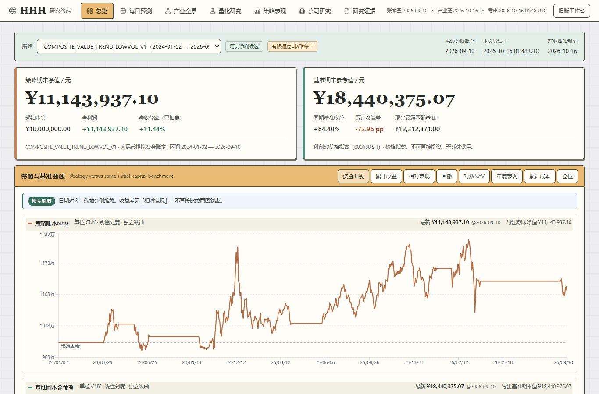

# HHH · A-share Research Workbench / A 股研究工作台

**Explore the evidence behind a strategy. / 看见策略背后的证据。**

An independent research project by **Haohan Wang**, bringing daily A-share screening, sector research and strategy evaluation into one browser-based workspace.

由 **王浩翰（Haohan Wang）** 独立推进的研究项目，将每日 A 股筛选、产业研究与策略评估放在同一个可交互的工作台中。

### [Open HHH / 打开在线演示](https://kennyscannotkillme.github.io/kennys.github.io/HHH/)

No account or installation required. Desktop and mobile supported. / 无需注册或安装，支持电脑与手机。



*Actual dashboard capture, 20 October 2026. Historical simulated portfolio; dates and limitations are shown in the interface. / 2026 年 10 月 20 日实际页面截图；图中为历史模拟组合，页面明确显示数据日期与研究限制。*

## What you can explore / 可以探索什么

| Area / 模块 | What it shows / 主要内容 |
| --- | --- |
| Daily research / 每日研究 | Screening across 5,353 eligible Shanghai, Shenzhen and Beijing A-shares; a separate 20-ETF universe; T+1, T+3 and T+5 observation journals. / 沪深北 5,353 只符合条件的 A 股、独立的 20 只 ETF 范围，以及三个观察周期的记录。 |
| Strategy comparison / 策略对比 | Simulated NAV, benchmark comparisons, drawdowns, costs and exposure, with dates and units visible. / 模拟净值、基准、回撤、成本与仓位，并显示对应日期与单位。 |
| Sector and company research / 产业与公司研究 | An interactive industry panorama and company research views. / 可交互的产业全景与公司研究视图。 |
| Quant research and evidence / 量化研究与证据 | Model and factor research, source-linked results and explicit validation limitations. / 模型与因子研究、可追溯结果及明确的验证限制。 |

## Why this project / 为什么做 HHH

Research is easier to judge when its assumptions, data dates and unsuccessful results remain visible. HHH turns a private research workflow into an inspectable public demonstration. AI tools assist development; data processing and numerical calculations are performed by code, and displayed values are checked against their source artifacts.

研究的假设、数据日期与未成功的结果都应该保留下来，方便判断。HHH 将个人研究流程整理成可以公开查看的演示。开发使用 AI 辅助工具；数据处理和数值计算由程序完成，页面展示值与源文件核对。

## Read the results correctly / 如何理解结果

- **Research snapshot, not a live trading service.** The daily journal in this release uses 19 October 2026 signals, with a scheduled 21 October entry reference. Historical strategy data ends on 10 September 2026; sector research has its own date. / **这是研究快照。** 本版每日记录使用 2026 年 10 月 19 日信号，计划入场参考日为 10 月 21 日；历史策略数据截至 9 月 10 日，产业研究另有日期。
- Scores are composite research rankings, **not expected returns or probabilities**. A result is recorded only when its observation becomes available; pending outcomes remain pending. / 评分是综合研究排名，**不等于预期收益或概率**；结果实际可观察后才记录，尚未发生的结果保持待观察。
- Charts show **historical simulated performance**, not personal brokerage holdings or live profit. Backtests do not establish future returns; this release does not claim a validated profitable strategy. / 图表展示**历史模拟表现**，不代表个人券商持仓或实盘盈利，也不宣称已验证的盈利策略。
- This public site contains sanitized research artifacts. Private accounts, credentials, databases and execution systems are excluded. / 公开站点仅包含整理后的研究文件，不包含私人账户、凭据、数据库或交易执行系统。

## Repository guide / 仓库说明

```text
index.html          Existing personal homepage / 原个人主页
HHH/                HHH frontend source and published static site / 前端源码与静态站点
  components/       React interface / React 界面
  public/           Sanitized research snapshots / 公开研究快照
  github-pages/     Static entry point / 静态入口
  scripts/          Frontend build scripts / 前端构建脚本
  assets/           Published browser assets / 已发布网页资源
docs/images/        Actual interface preview / 实际界面预览
```

**Interface:** React, TypeScript, Tailwind CSS, Recharts and Vite. **Research pipeline:** Python, pandas, SQLite and Qlib; the private data and model-generation pipeline is not included in this repository.

**界面技术：** React、TypeScript、Tailwind CSS、Recharts 与 Vite。**研究流程：** Python、pandas、SQLite 与 Qlib；本仓库不包含私人数据及模型生成流程。

### Run the published snapshot / 本地查看已发布版本

```sh
git clone https://github.com/kennyscannotkillme/kennys.github.io.git
cd kennys.github.io
python -m http.server 8000
```

Open `http://localhost:8000/HHH/`. / 浏览器打开上述地址。

### Build the frontend / 构建前端

Use Node.js 22.13 or later and pnpm. / 使用 Node.js 22.13 或以上版本及 pnpm。

```sh
cd HHH
pnpm install --frozen-lockfile
node scripts/github-pages.mjs
node --test tests/github-pages.test.mjs tests/activity.test.mjs tests/research.test.mjs
```

The static export is written to `HHH/outputs/github-pages/HHH/`. Building the frontend uses the included snapshots and does not fetch fresh market data. / 静态输出位于上述目录；前端构建使用仓库快照，不会自动获取新行情。

## Feedback and support / 反馈与支持

Found an unclear chart, a data inconsistency or a mobile layout issue? [Open an issue](https://github.com/kennyscannotkillme/kennys.github.io/issues) with the page, displayed date and steps to reproduce. Please omit personal account details and credentials.

如果发现图表难理解、数据不一致或手机排版问题，欢迎 [提交 Issue](https://github.com/kennyscannotkillme/kennys.github.io/issues)，附上页面、显示日期和复现步骤，请勿包含私人账户信息或凭据。

**If HHH helps you think more clearly about research, a star is appreciated. / 如果 HHH 能帮助你更清楚地理解研究，欢迎点一颗 Star。**
